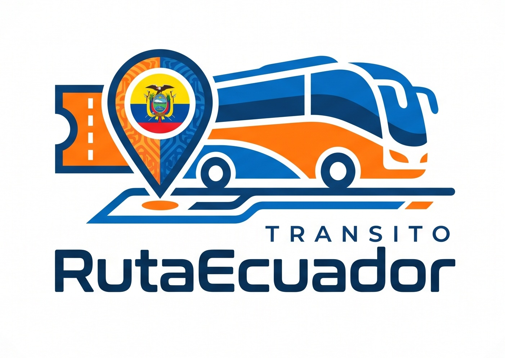

  

  # 🚌 Transporte Interprovincial 🇪🇨

  ### 🎫 Aplicación web para la gestión y venta de pasajes interprovinciales

  **Conectando destinos, facilitando viajes y mejorando la experiencia de los pasajeros.**

  
  
  
  
  
  
  

  **🗺️ Planifica rutas · 💺 Elige tu asiento · 💳 Gestiona pagos · 🎟️ Valida boletos**

  [📌 Acerca del proyecto](#-acerca-del-proyecto) ·
  [✨ Funcionalidades](#-funcionalidades-principales) ·
  [🚀 Instalación](#-instalación-y-ejecución) ·
  [🤝 Contribuciones](#-contribuciones)
  [🐛 Reportar un error](https://github.com/ReaperMag/Transporte-Interprovincial/issues) ·
  [💡 Solicitar una mejora](https://github.com/ReaperMag/Transporte-Interprovincial/issues)

---

## 📚 Tabla de contenidos

- [🚌 Acerca del proyecto](#-acerca-del-proyecto)
- [🎯 Objetivos](#-objetivos)
- [👥 Módulos y roles del sistema](#-módulos-y-roles-del-sistema)
- [✨ Funcionalidades principales](#-funcionalidades-principales)
- [🧰 Tecnologías y herramientas](#-tecnologías-y-herramientas)
- [🚀 Instalación y ejecución](#-instalación-y-ejecución)
- [📍 Estado del proyecto](#-estado-del-proyecto)
- [🤝 Contribuciones](#-contribuciones)
- [📄 Licencia](#-licencia)
- [📬 Contacto](#-contacto)
- [📖 Guía de contribución](#-flujo-de-trabajo-y-control-de-cambios)

---

## 🚌 Acerca del proyecto

**Transporte Interprovincial** es una aplicación web académica orientada a facilitar la búsqueda, administración y venta de pasajes de transporte interprovincial en Ecuador. La plataforma busca reunir en un mismo sistema a las cooperativas de transporte, el personal de oficina, el personal de los buses y los pasajeros.

El sistema contempla la administración de cooperativas, buses, rutas, frecuencias, hojas de ruta, asientos, reservas, pagos y boletos. También considera la validación de boletos durante el viaje y el envío de notificaciones sobre los cambios importantes en las compras.

Este proyecto se desarrolla como parte del proyecto del segundo parcial de la asignatura **Manejo y Configuración de Software**, de la Carrera de Software de la **Universidad Técnica de Ambato**.

### 🌟 ¿Qué busca mejorar?

- 🏢 Organizar la información de las cooperativas y sus unidades.
- 🗺️ Facilitar la consulta de rutas, frecuencias y destinos.
- 💺 Ayudar a los pasajeros a seleccionar asientos disponibles.
- 🎟️ Centralizar los procesos de reserva, compra y validación de boletos.
- 💳 Llevar un control de los pagos y sus comprobantes.
- 🔄 Favorecer el trabajo colaborativo mediante Git, GitHub y una herramienta de seguimiento de cambios.

## 🎯 Objetivos

- 📂 Centralizar la información de cooperativas, buses, rutas y frecuencias.
- 🔎 Facilitar la búsqueda de viajes y la selección de asientos disponibles.
- 🧾 Gestionar la compra, reserva, revisión de comprobantes y emisión de boletos.
- 🚌 Apoyar la planificación diaria de los buses mediante hojas de ruta.
- 📱 Validar los boletos y registrar el acceso de los pasajeros al bus.
- 🔔 Considerar notificaciones relacionadas con reservas, pagos y compras.
- 🧑‍💻 Aplicar buenas prácticas de control de versiones y gestión de cambios durante el desarrollo colaborativo.

## 👥 Módulos y roles del sistema

El sistema contempla diferentes roles. Cada uno tendrá acceso a las funciones relacionadas con sus responsabilidades.

### 🔑 1. Administrador

El administrador se encarga de la gestión general de las cooperativas registradas en la plataforma.

- ➕ Crear cooperativas.
- 🔎 Consultar la información de las cooperativas.
- ✏️ Actualizar sus datos.
- 🗑️ Eliminar registros cuando corresponda.

### 🏢 2. Cooperativa

Cada cooperativa podrá gestionar la información operativa relacionada con sus buses, rutas y frecuencias.

- 🎨 Configurar elementos visuales de la cooperativa, como el logotipo y los colores.
- 🚌 Registrar y administrar sus buses y sus características.
- 🧩 Crear grupos de buses y asignar vehículos a cada grupo.
- 🕒 Registrar frecuencias con origen, destino, hora y número de resolución de referencia.
- 🗺️ Definir rutas directas y rutas con paradas intermedias.
- 📋 Elaborar hojas de ruta diarias a partir de las frecuencias activas y los buses disponibles.
- 🛠️ Organizar los días de parada de los vehículos.
- 🚍 Mantener buses de reserva para atender contingencias.

### 🧾 3. Oficinista

El oficinista se encarga de la venta presencial y de revisar los comprobantes de pago enviados por los pasajeros.

- 🎟️ Gestionar la venta de boletos en oficina.
- 💵 Registrar pagos en efectivo realizados en la oficina.
- 🏦 Revisar comprobantes de depósitos y transferencias.
- ✅ Aprobar comprobantes válidos.
- ❌ Rechazar comprobantes que no cumplan los requisitos.
- 🧾 Participar en el proceso de emisión del boleto una vez validado el pago.

### 🧑‍✈️ 4. Personal del bus

Este rol comprende al personal asignado al bus, como el conductor o controlador, según la organización del servicio.

- 🚌 Acceder a los viajes y buses que tenga asignados.
- ▶️ Iniciar y finalizar viajes.
- 📷 Validar boletos mediante la lectura de su código QR.
- 💺 Registrar la ocupación de los asientos.
- 📚 Consultar el historial y los reportes de viajes anteriores.
- 🎫 Registrar ventas de boletos durante el trayecto cuando existan asientos disponibles.
- 🧍 Ingresar los datos requeridos del pasajero, el precio y el destino correspondiente para las ventas durante el recorrido.

### 🧳 5. Usuario final o pasajero

El pasajero podrá consultar las opciones de viaje y gestionar sus compras desde la aplicación.

- 🔎 Buscar viajes por ciudad de origen, destino y fecha.
- 🏢 Consultar y filtrar opciones por cooperativa.
- 💺 Filtrar por tipo de asiento, como normal o VIP, y por modalidad de recorrido.
- 🚌 Revisar la información disponible del bus y del recorrido.
- 🪑 Seleccionar asientos y registrar los datos de los pasajeros.
- 🧑‍🦽 Aplicar las categorías de descuento contempladas por el sistema, como menor de edad, tercera edad y discapacidad, sujetas a validación.
- ⏳ Reservar asientos durante un tiempo limitado.
- 💳 Seleccionar el método de pago y enviar el comprobante cuando corresponda.
- 🧾 Consultar el historial de compras y volver a visualizar sus boletos.
- 🔔 Recibir notificaciones sobre el estado de sus reservas, pagos y compras.

## ✨ Funcionalidades principales

### 🔎 Búsqueda y selección de viajes

La aplicación permitirá consultar las frecuencias disponibles según el origen, destino y fecha del viaje. Los resultados podrán filtrarse por cooperativa, tipo de asiento y modalidad de recorrido.

Cuando la información esté disponible, se contempla mostrar datos del bus como número, placa, chasis, carrocería y fotografía.

### 🚌 Administración de buses y asientos

Cada cooperativa podrá registrar las características de sus buses y definir su distribución de asientos. Se consideran diferentes tipos de asiento, como normal y VIP, así como plantillas de distribución que contemplen los pisos y las características de cada vehículo.

### 🗺️ Rutas, frecuencias y hojas de ruta

Las frecuencias incluirán origen, destino, hora y un número de resolución ingresado como referencia. La cooperativa podrá seleccionar las frecuencias activas para organizar sus hojas de ruta diarias y asignar los buses correspondientes.

La planificación también contempla los días de parada de los vehículos y la disponibilidad de unidades de reserva para atender posibles contingencias.

### 🎟️ Reservas, pagos y boletos

El proceso de compra contempla los siguientes pasos:

1. 🔎 Buscar un viaje disponible.
2. 💺 Seleccionar los asientos.
3. 🧍 Ingresar los datos de los pasajeros.
4. 🧾 Revisar el resumen de la compra y los descuentos aplicables.
5. 💳 Elegir el método de pago.
6. 📤 Enviar el comprobante cuando se realice un depósito o transferencia.
7. 🕵️ Esperar la revisión del personal autorizado cuando corresponda.
8. 🎫 Obtener el boleto una vez cumplidas las condiciones requeridas.

Se consideran pagos en efectivo en oficina, depósitos y transferencias bancarias. Los comprobantes deberán ser revisados por el personal autorizado antes de confirmar el pago y emitir el boleto.

⏳ **Tiempo de reserva:** los asientos reservados tendrán un límite de tiempo para completar el proceso de pago. Si el tiempo vence sin que se cumplan las condiciones requeridas, los asientos podrán liberarse nuevamente.

### 📷 Validación de boletos mediante QR

El personal del bus podrá validar los boletos mediante el código QR asociado a cada compra. Una vez registrado el acceso, el boleto deberá quedar invalidado para evitar que se utilice nuevamente.

### 🧾 Venta de boletos durante el trayecto

Se contempla que el personal autorizado registre ventas durante el recorrido cuando existan asientos disponibles. En el registro se deberán considerar los datos del pasajero, el precio y el destino correspondiente.

### 🔔 Notificaciones e historial

Se contempla enviar notificaciones por correo electrónico sobre cambios relevantes del proceso de compra, como reservas, comprobantes, aprobaciones y emisión de boletos. Los usuarios podrán consultar su historial de compras y sus boletos.

## 🧰 Tecnologías y herramientas

| 🧩 Componente | 🛠️ Tecnología | 📂 Ubicación |
|---|---|---|
| 🖥️ Frontend | React, Vite y TypeScript | `apps/web` |
| ⚙️ Backend | FastAPI y SQLAlchemy (Python) | `apps/api` |
| 🔗 Tipos compartidos | Paquete de tipos compartidos | `packages/shared-types` |
| 🌿 Control de versiones | Git y Git Flow | GitHub |

## 🚀 Instalación y ejecución

PROXIMAMENTE

## 📍 Estado del proyecto

🚧 **En desarrollo académico.**

Las funcionalidades descritas representan el alcance previsto y deberán actualizarse conforme se implementen, prueben y validen los módulos.

🔎 Consulta las [issues abiertas](https://github.com/ReaperMag/Transporte-Interprovincial/issues) para revisar tareas, errores reportados y mejoras propuestas.

## 🤝 Contribuciones

¡La colaboración del equipo es fundamental! 💙 Antes de contribuir, revisa las reglas de ramas, commits y Pull Requests descritas en [Flujo de trabajo y control de cambios](#-flujo-de-trabajo-y-control-de-cambios).

### 💡 ¿Cómo proponer un cambio?

1. 🔍 Crea o revisa una issue relacionada con la tarea.
2. 🌱 Crea la rama correspondiente siguiendo Git Flow.
3. 💻 Implementa los cambios y utiliza Conventional Commits.
4. 🧪 Ejecuta las verificaciones locales del área modificada.
5. 📤 Publica la rama y abre un Pull Request hacia la rama base correcta.
6. 👀 Espera las aprobaciones y la revisión funcional.
7. ✅ Integra los cambios mediante *merge commit* una vez aprobados.

- 🐛 [Reportar un error o proponer una mejora](https://github.com/ReaperMag/Transporte-Interprovincial/issues).

## 📄 Licencia

Este proyecto se distribuye bajo los términos de la **GNU General Public License v3.0 (GPL-3.0)**.

La licencia permite usar, estudiar, compartir y modificar el software conforme a sus condiciones. Cuando se redistribuye el programa o una versión modificada, deben respetarse los requisitos de la GPL, incluidos los avisos de licencia y las obligaciones aplicables sobre la disponibilidad del código fuente.

📜 Consulta el archivo [`LICENSE`](LICENSE) incluido en el repositorio para leer el texto completo de la licencia.

## 📬 Contacto

- 🐙 **Repositorio:** [ReaperMag/Transporte-Interprovincial](https://github.com/ReaperMag/Transporte-Interprovincial)
- 🐛 **Errores, preguntas y sugerencias:** [GitHub Issues](https://github.com/ReaperMag/Transporte-Interprovincial/issues)

---

  ### 🚌 ¡Conectando destinos, facilitando viajes! 🇪🇨

  Desarrollado con 💙 como proyecto académico de la Carrera de Software de la Universidad Técnica de Ambato.

  ⭐ **Si te interesa el proyecto, puedes visitarlo y seguir su avance en GitHub.**

<a href="#readme-top">⬆️ Volver al inicio</a>

